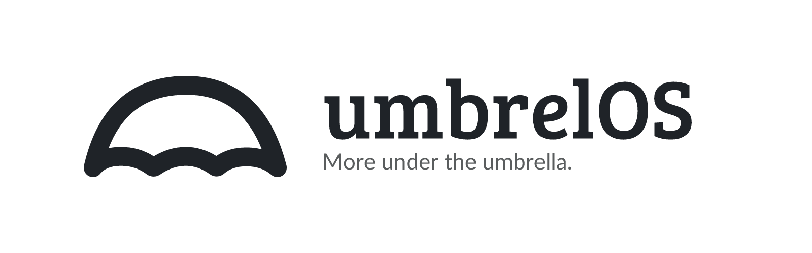
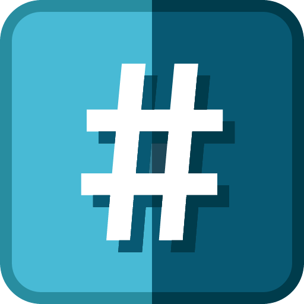
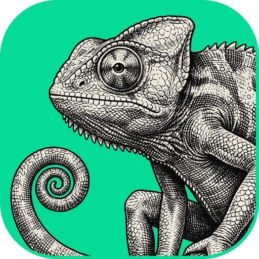
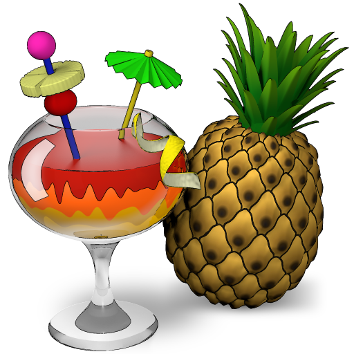
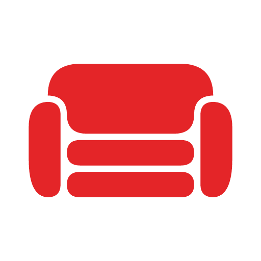
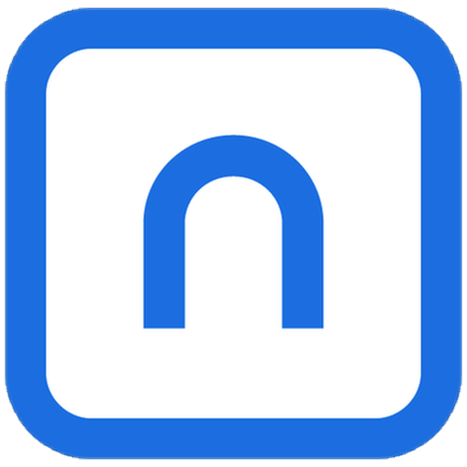

<p align="center">
  <picture>
    <source media="(prefers-color-scheme: dark)" srcset=".github/assets/banner-dark.png">
    
  </picture>
</p>

<p align="center">
  <a href="https://github.com/junkerderprovinz/umbrel-apps/actions/workflows/generate.yml"></a>&nbsp;
  <a href="#apps"></a>&nbsp;
  <a href="https://github.com/junkerderprovinz/umbrel-apps/commits/main"></a>&nbsp;
  <a href="https://umbrel.com/umbrelos"></a>&nbsp;
  <a href="LICENSE"></a>
</p>

<p align="center">
A community app store for <a href="https://umbrel.com/umbrelos">umbrelOS</a> with junkerderprovinz's containers, grouped like the profile: <b>Apps</b> (my own software), <b>Images</b> (my own image builds of third-party apps) and <b>Wrappers</b> (thin templates over an upstream image). One store to add; each app's image and full source live in its own repository.
</p>


<!-- apps:start -->
## Apps

*My own software, built and published by junkerderprovinz. Full docs live in each app's own repository.*

<a id="arrowloop"></a>

<a href="https://github.com/junkerderprovinz/arrowloop#readme"></a>
<a href="https://github.com/junkerderprovinz/arrowloop/blob/main/compose.yaml"></a>

**ArrowLoop**<br>
Two-way file sync that shows you the plan before it touches a file, sends deletions to a trash and stops a run that would delete too much.

<br clear="all">

<a id="featherdrop"></a>

<a href="https://github.com/junkerderprovinz/featherdrop#readme"></a>
<a href="https://github.com/junkerderprovinz/featherdrop/blob/main/compose.yaml"></a>

**featherdrop**<br>
Your own private WeTransfer: feather-light, login-free, end-to-end encrypted file sharing with self-expiring share links.

<br clear="all">

<a id="knightloader"></a>

<a href="https://github.com/junkerderprovinz/knightloader#readme"></a>
<a href="https://github.com/junkerderprovinz/knightloader/blob/main/compose.yaml"></a>

**KnightLoader**<br>
Self-hosted download manager for hosters, debrid, torrents, Usenet and video, with an Android app and a browser extension.

<br clear="all">

<a id="trickwork"></a>

<a href="https://github.com/junkerderprovinz/trickwork#readme"></a>
<a href="https://github.com/junkerderprovinz/trickwork/blob/main/compose.yaml"></a>

**TrickWork**<br>
Turns images into proportional-font-aware ASCII art - a rebuild of ASCII Gen 2, picking characters by real ink coverage, not brightness.

<br clear="all">


## Images

*My own custom image builds of third-party apps. Full docs in each app's own repository.*

<a id="cadcraft"></a>

<a href="https://github.com/junkerderprovinz/artcraft-apps#cadcraft"></a>
<a href="https://github.com/junkerderprovinz/artcraft-apps/blob/main/compose/cadcraft.yaml"></a>

**CADCraft**<br>
CADCraft on a Selkies web desktop: 2D drafting with layers, blocks and dimensions, and DXF and DWG files, all in the browser.

<br clear="all">

<a id="deckcraft"></a>

<a href="https://github.com/junkerderprovinz/artcraft-apps#deckcraft"></a>
<a href="https://github.com/junkerderprovinz/artcraft-apps/blob/main/compose/deckcraft.yaml"></a>

**DeckCraft**<br>
DeckCraft on a Selkies web desktop, for building and presenting PowerPoint decks from any browser.

<br clear="all">

<a id="designcraft"></a>

<a href="https://github.com/junkerderprovinz/artcraft-apps#designcraft"></a>
<a href="https://github.com/junkerderprovinz/artcraft-apps/blob/main/compose/designcraft.yaml"></a>

**DesignCraft**<br>
DesignCraft on a Selkies web desktop: lay out magazines and flyers in the browser and export print-ready PDFs.

<br clear="all">

<a id="effectcraft"></a>

<a href="https://github.com/junkerderprovinz/artcraft-apps#effectcraft"></a>
<a href="https://github.com/junkerderprovinz/artcraft-apps/blob/main/compose/effectcraft.yaml"></a>

**EffectCraft**<br>
EffectCraft on a Selkies web desktop, for motion graphics with compositions, keyframes and effects in the browser.

<br clear="all">

<a id="euro-office"></a>

<a href="https://github.com/junkerderprovinz/euro-office#readme"></a>
<a href="https://github.com/junkerderprovinz/euro-office/blob/main/compose.yaml"></a>

**Euro Office**<br>
Sovereign, OnlyOffice-compatible document server for browser editing of Office and OpenDocument files, wired into OpenCloud over WOPI.

<br clear="all">

<a id="excalidraw"></a>

<a href="https://github.com/junkerderprovinz/excalidraw#readme"></a>
<a href="https://github.com/junkerderprovinz/excalidraw/blob/main/compose.yaml"></a>

**Excalidraw**<br>
The hand-drawn whiteboard, built so it keeps to itself: shared links, live collaboration, the session scene and even the fonts all come from your own server.

<br clear="all">

<a id="figcraft"></a>

<a href="https://github.com/junkerderprovinz/artcraft-apps#figcraft"></a>
<a href="https://github.com/junkerderprovinz/artcraft-apps/blob/main/compose/figcraft.yaml"></a>

**FigCraft**<br>
FigCraft on a Selkies web desktop: design interfaces with frames and components and click through prototypes in the browser.

<br clear="all">

<a id="filmcraft"></a>

<a href="https://github.com/junkerderprovinz/artcraft-apps#filmcraft"></a>
<a href="https://github.com/junkerderprovinz/artcraft-apps/blob/main/compose/filmcraft.yaml"></a>

**FilmCraft**<br>
FilmCraft on a Selkies web desktop, a nonlinear video editor that cuts the footage on your array from any browser.

<br clear="all">

<a id="garage"></a>

<a href="https://github.com/junkerderprovinz/garage#readme"></a>
<a href="https://github.com/junkerderprovinz/garage/blob/main/compose.yaml"></a>

**Garage**<br>
Garage's S3-compatible object store and its web admin panel in one container, with the single-node layout and S3 keys created automatically.

<br clear="all">

<a id="gridcraft"></a>

<a href="https://github.com/junkerderprovinz/artcraft-apps#gridcraft"></a>
<a href="https://github.com/junkerderprovinz/artcraft-apps/blob/main/compose/gridcraft.yaml"></a>

**GridCraft**<br>
GridCraft on a Selkies web desktop: a spreadsheet with formulas and charts that opens and saves Excel workbooks.

<br clear="all">

<a id="handbrake"></a>

<a href="https://github.com/junkerderprovinz/handbrake#readme"></a>
<a href="https://github.com/junkerderprovinz/handbrake/blob/main/compose.yaml"></a>

**HandBrake**<br>
HandBrake's full GUI on a fast Selkies web desktop, GPU-accelerated on NVIDIA, Intel and AMD, with a watch folder that converts on its own.

<br clear="all">

<a id="jdownloader"></a>

<a href="https://github.com/junkerderprovinz/jdownloader#readme"></a>
<a href="https://github.com/junkerderprovinz/jdownloader/blob/main/compose.yaml"></a>

**JDownloader**<br>
JDownloader 2 with a complete, sleek dark UI out of the box, on a fast Selkies web desktop in your browser. No VNC client, no install.

<br clear="all">

<a id="krusader"></a>

<a href="https://github.com/junkerderprovinz/krusader#readme"></a>
<a href="https://github.com/junkerderprovinz/krusader/blob/main/compose.yaml"></a>

**Krusader**<br>
Twin-pane KDE file manager with a native dark theme on a fast Selkies web desktop, with Kate, krename and RAR built in.

<br clear="all">

<a id="lightcraft"></a>

<a href="https://github.com/junkerderprovinz/artcraft-apps#lightcraft"></a>
<a href="https://github.com/junkerderprovinz/artcraft-apps/blob/main/compose/lightcraft.yaml"></a>

**LightCraft**<br>
LightCraft on a Selkies web desktop, a photo library and raw developer that sits right next to the photos on your array.

<br clear="all">

<a id="pdfcraft"></a>

<a href="https://github.com/junkerderprovinz/artcraft-apps#pdfcraft"></a>
<a href="https://github.com/junkerderprovinz/artcraft-apps/blob/main/compose/pdfcraft.yaml"></a>

**PdfCraft**<br>
PdfCraft on a Selkies web desktop, for reading, editing, signing and running OCR on PDFs in the browser.

<br clear="all">

<a id="photocraft"></a>

<a href="https://github.com/junkerderprovinz/artcraft-apps#photocraft"></a>
<a href="https://github.com/junkerderprovinz/artcraft-apps/blob/main/compose/photocraft.yaml"></a>

**PhotoCraft**<br>
PhotoCraft on a Selkies web desktop: a layered photo editor in the browser that opens PSD, Krita and Affinity files.

<br clear="all">

<a id="prusaslicer"></a>

<a href="https://github.com/junkerderprovinz/prusaslicer#readme"></a>
<a href="https://github.com/junkerderprovinz/prusaslicer/blob/main/compose.yaml"></a>

**PrusaSlicer**<br>
The PrusaSlicer 3D-printing slicer in your browser on a fast Selkies web desktop: slice and export G-code, no VNC client (amd64 + arm64).

<br clear="all">

<a id="seafile"></a>

<a href="https://github.com/junkerderprovinz/seafile#readme"></a>
<a href="https://github.com/junkerderprovinz/seafile/blob/main/compose.yaml"></a>

**Seafile**<br>
The official Seafile server from one template, with its secrets generated on first start and MariaDB, Redis and the notification server built in on request.

<br clear="all">

<a id="securo"></a>

<a href="https://github.com/junkerderprovinz/securo#readme"></a>
<a href="https://github.com/junkerderprovinz/securo/blob/main/compose.yaml"></a>

**Securo**<br>
The Securo finance manager with its worker and scheduler in one container, on your own PostgreSQL and Redis or on built-in ones.

<br clear="all">

<a id="soundcraft"></a>

<a href="https://github.com/junkerderprovinz/artcraft-apps#soundcraft"></a>
<a href="https://github.com/junkerderprovinz/artcraft-apps/blob/main/compose/soundcraft.yaml"></a>

**SoundCraft**<br>
SoundCraft on a Selkies web desktop, a multitrack audio workstation whose sound plays in the browser.

<br clear="all">

<a id="stellarium"></a>

<a href="https://github.com/junkerderprovinz/stellarium#readme"></a>
<a href="https://github.com/junkerderprovinz/stellarium/blob/main/compose.yaml"></a>

**Stellarium**<br>
The Stellarium planetarium in your browser on a fast Selkies web desktop: pan the sky, zoom a nebula, scrub through time, no VNC client.

<br clear="all">

<a id="vectorcraft"></a>

<a href="https://github.com/junkerderprovinz/artcraft-apps#vectorcraft"></a>
<a href="https://github.com/junkerderprovinz/artcraft-apps/blob/main/compose/vectorcraft.yaml"></a>

**VectorCraft**<br>
VectorCraft on a Selkies web desktop: vector illustration with paths and type, SVG and PDF in and out.

<br clear="all">

<a id="wordcraft"></a>

<a href="https://github.com/junkerderprovinz/artcraft-apps#wordcraft"></a>
<a href="https://github.com/junkerderprovinz/artcraft-apps/blob/main/compose/wordcraft.yaml"></a>

**WordCraft**<br>
WordCraft on a Selkies web desktop, a word processor in the browser that opens and saves Word documents.

<br clear="all">


## Wrappers

*Thin templates over a third-party upstream image (no custom build). Full docs in each app's folder below.*

<a id="couchdb"></a>

<a href="https://github.com/junkerderprovinz/unraid-apps/blob/main/couchdb/README.md"></a>
<a href="https://github.com/junkerderprovinz/unraid-apps/blob/main/couchdb/compose.yaml"></a>

**CouchDB**<br>
The HTTP/JSON document database behind Obsidian LiveSync, on the official 3.x image with data, config and CORS mapped so they survive a recreate or update.

<br clear="all">

<a id="rustfs"></a>

<a href="https://github.com/junkerderprovinz/unraid-apps/blob/main/rustfs/README.md"></a>
<a href="https://github.com/junkerderprovinz/unraid-apps/blob/main/rustfs/compose.yaml"></a>

**RustFS**<br>
An S3 object store in Rust, with the two fixes it needs to run on Unraid at all. Pre-release: every version so far is a release candidate.

<br clear="all">

<a id="seaweedfs"></a>

<a href="https://github.com/junkerderprovinz/unraid-apps/blob/main/seaweedfs/README.md"></a>
<a href="https://github.com/junkerderprovinz/unraid-apps/blob/main/seaweedfs/compose.yaml"></a>

**SeaweedFS**<br>
Fast, S3-API-compatible object store on the official image, the actively-maintained alternative now that MinIO's open edition is done.

<br clear="all">

<a id="silo"></a>

<a href="https://github.com/junkerderprovinz/unraid-apps/blob/main/silo/README.md"></a>
<a href="https://github.com/junkerderprovinz/unraid-apps/blob/main/silo/compose.yaml"></a>

**Silo**<br>
MinIO, still maintained: PGSTY's fork of the open-source server, with the full web console. It reads an existing MinIO data folder as it is.

<br clear="all">

<a id="standardnotes-webui"></a>

<a href="https://github.com/junkerderprovinz/unraid-apps/blob/main/standardnotes-webui/README.md"></a>
<a href="https://github.com/junkerderprovinz/unraid-apps/blob/main/standardnotes-webui/compose.yaml"></a>

**Standard Notes Web UI**<br>
The official Standard Notes web client, self-hosted next to your own sync server for end-to-end encrypted notes in the browser.

<br clear="all">

<a id="versitygw"></a>

<a href="https://github.com/junkerderprovinz/unraid-apps/blob/main/versitygw/README.md"></a>
<a href="https://github.com/junkerderprovinz/unraid-apps/blob/main/versitygw/compose.yaml"></a>

**VersityGW**<br>
An S3 API in front of a share you already have: top-level folders become buckets, and every file stays readable over SMB and NFS at the same time.

<br clear="all">
<!-- apps:end -->


## Install

On umbrelOS: open the **App Store**, click the three dots at the top right, choose **Community App Stores** and add

```
https://github.com/junkerderprovinz/umbrel-apps
```

The apps then appear under **Junker der Provinz App Store**. Umbrel checks the store every few minutes and offers an update when an app's version moves on.

Apps that need a login of their own start with the user `umbrel` and the password umbrelOS creates for each install; it shows the password next to the app. Change them in the app before you store real data.

Questions and bugs go to the issue tracker of the app's own repository; every app links it under **Support**.


## How these differ from the Unraid templates

The apps are built from the Unraid templates in [unraid-apps](https://github.com/junkerderprovinz/unraid-apps), through the same compose files the app repositories offer for other Docker hosts, with the changes umbrelOS needs:

- Every web interface sits behind Umbrel's app proxy on a port of its own, 35101 and up.
- Umbrel's login guards the apps that have none of their own. It is off for the apps whose own clients have to reach them: KnightLoader, ArrowLoop, featherdrop's share links, CouchDB, Seafile and Euro-Office.
- Appdata goes to the app's data folder. File managers, slicers and download managers see umbrelOS' shared storage, downloads land in its **Downloads** folder.
- `PUID` and `PGID` are `1000`, the user umbrelOS runs its apps as.
- S3 and the other ports that are not a web page move to ports of their own as well, 35201 and up. Their usual numbers clash with apps in Umbrel's store and with each other. Each app's description in umbrelOS lists its ports.
- Apps without a web page of their own (JuiceFS, ParleyPort) and apps that need a database next to them (Matrix, n8n, Claper) are not in the store yet. Neither is OpenCloud: its login service accepts only an https:// address, and Umbrel's app proxy talks plain HTTP to the app.

To change an app, edit its template in unraid-apps, not the app folders, `.github/readme-icons/` or the app list in this README. A workflow here rebuilds them every night. To build them by hand:

```sh
python3 tools/generate.py ../unraid-apps
```

`apps.json` lists the apps in the store with their Umbrel port and category. Per app it can also name the port the proxy talks to (`web_port`), give the other ports their Umbrel port (`host_ports`), turn Umbrel's login off (`auth`), set where a folder goes (`paths`), leave a path out (`drop_paths`), set variables (`env`), name the login shown next to the app (`username`), name the upstream developer (`developer`), read a template file with another name (`xml`) or replace the short text and description (`tagline`, `description`).


## How AI is used here

One knight builds this, and AI is one of the tools I work with, the same way I work with an editor or a compiler. It helps me write code and documentation and it checks my work, and that saves me a good many evenings. It does not make the decisions, though. I read and understand everything before it ships, and if something here breaks, that is on me and not on the tool.

You do not have to take my word for it. The code is open and every release note is written by hand. The issue tracker shows how problems actually get handled, including the ones I got wrong the first time. If you find something that is not right, open an issue and I will look at it.

## Support

A one-knight job: I build them, keep them running, work through the issues and add what people ask for, until nothing is missing. They are free, with no accounts, no telemetry, no ads and no paid tier. No asterisk anywhere. Nothing readable ever leaves your own walls. Forged on evenings and weekends, with heart and stubbornness.

If one of these has earned a place on your server or computer, toss a coin to your knight: it helps cover the costs and keeps the project alive. It also makes this knight's heart beat a little faster. Three ways below, whichever suits you.

<p align="center">
  <a href="https://buymeacoffee.com/junkerderprovinz"></a>
  &nbsp;
  <a href="https://www.paypal.com/donate/?hosted_button_id=76FVV52TKXTUS"></a>
  &nbsp;
  <a href="https://junkerderprovinz.github.io/junkerderprovinz/"></a>
</p>
